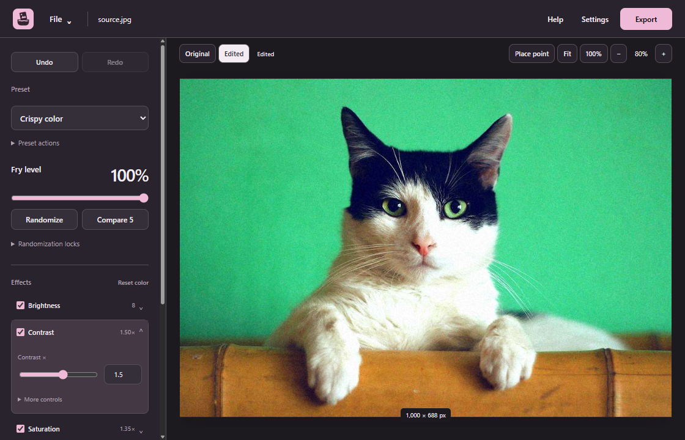
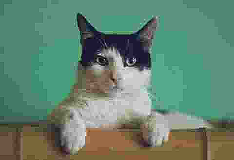
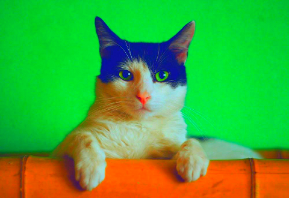

# Deep Fryer

[](https://github.com/ShiosOS/Deep-Fryer/actions/workflows/windows.yml)

A local Windows image editor for deep-fried memes. Push colors, add noise and JPEG damage, and warp faces with bulge or pinch points. Start with a preset, adjust the result, then copy it into another app or export an image. No account or upload required.



The screenshot and effect examples below show the existing 0.4.0 editor and help media. The download links point to that published release. Changes made after 0.4.0 require a new build and are not included in that installer.

## Download for Windows

[Download Deep Fryer 0.4.0](https://github.com/ShiosOS/Deep-Fryer/releases/download/v0.4.0/DeepFryer-Setup-0.4.0.exe) · [Release notes](https://github.com/ShiosOS/Deep-Fryer/releases/tag/v0.4.0) · [SHA256SUMS.txt](https://github.com/ShiosOS/Deep-Fryer/releases/download/v0.4.0/SHA256SUMS.txt)

The installer is for Windows x64 and includes the app runtime. You do not need Node.js to use it. macOS and Linux packages are not provided.

The 0.4.0 installer is **unsigned**. Windows may show an unknown-publisher or SmartScreen warning. Download only from the release above. Verify the checksum before deciding whether to run it. A matching checksum confirms the published bytes, not publisher identity or safety. Do not disable Windows security protections to install it.

In PowerShell, run this command in the folder containing the download:

```powershell
Get-FileHash -LiteralPath .\DeepFryer-Setup-0.4.0.exe -Algorithm SHA256
```

The expected SHA-256 for that exact installer is:

```text
97e4b4f3e9192523a5ca991670cbaac20a71af872e43b8b6b77d77115ba0f27f
```

Compare it with `SHA256SUMS.txt` on the same release. If the values match and you trust the download, run the installer and choose an installation folder. Updates require downloading and running a newer installer.

## Make your first edit

1. Choose **File → Open image**, paste a copied image, or drop one PNG or JPEG into the window.
2. Choose **Crispy color**, **Noisy photocopy**, or **Overcooked** from **Preset**. The canvas shows the edited result.
3. Adjust **Fry level** or open an effect to change its settings. Use **Original** to compare, or Undo to restore the previous edit.
4. Choose **Copy image** to paste the edited result into another app. Wait for **Image copied** before pasting.
5. To save a file, choose **Export**, set its format, size, and name, then choose **Save image…** and a new destination.

To continue editing later, use **File → Save project as…**. Exported images do not retain editable effects. The **Help** button explains effects, point controls, and saving with illustrated examples.

## See what the effects do

These examples come from the production effect engine. Example settings and image hashes are in the [help media manifest](src/renderer/src/assets/help/manifest.json).

| Original | JPEG damage, then Sharpen | 5× saturation |
| --- | --- | --- |
|  |  |  |

## What you can do

- Stack, reorder, duplicate, blend, or disable eight effects: brightness, contrast, saturation, color levels, noise, sharpening, JPEG damage, and bulge or pinch.
- Push contrast and saturation to 5×. Drag distortion points on the canvas and adjust each point's radius and strength.
- Compare five draft fry levels, randomize unlocked parameters, and undo or redo edits.
- Save reusable `.frypreset` presets and editable `.deepfryer` projects with the original image embedded.
- Copy a PNG at the source's oriented dimensions with transparency. Copy always uses the edit, even while **Original** is visible, and ignores export settings.
- Export PNG, JPEG, or WebP at chosen dimensions. **Inspect final output** shows the encoded result, and **Save inspected snapshot** saves those exact bytes.
- Use light, dark, System, or custom colors. Zoom, pan, and switch between fit and actual size.

Common Windows shortcuts are `Ctrl+O` to open, `Ctrl+S` to save a project, `Ctrl+Shift+S` to open Export, `Ctrl+Shift+C` to copy, and `Ctrl+Z` to undo.

## Privacy and file safety

Deep Fryer processes images on your computer. The application has no account, image-upload service, telemetry, or automatic updater. Downloading releases and opening GitHub links use your browser's network connection.

Projects embed the original source bytes, which can include source metadata. Treat a project as sharing the original image. Export creates a new image from decoded pixels rather than copying the source metadata. Copy puts image data on the Windows clipboard, where other apps and enabled clipboard history or sync services may access it.

Recovery keeps two completed edit checkpoints in the local application data directory. After an interruption, checkpoints older than seven days are removed when recovery checks them. A clean exit or **Discard recovery** removes the recovery copies. Save a project for durable storage. Appearance settings are stored separately. See [file formats and storage](docs/files-and-storage.md).

Saves require a new filename. Existing files, including the source, stay protected even if a native chooser offers to replace them.

## Current limits

- Open PNG and JPEG images, one image at a time. WebP is an export format, not an input format.
- Input must fit within 64 MiB, 16,384 pixels per side, and 24 million pixels total. Exports have the same dimension and pixel limits and a 128 MiB encoded size limit.
- Large images and long effect stacks can take time and memory. A resized export can differ from the canvas because effects run at the output size.
- The editor has no text captions, drawing tools, animation or video editing, batch processing, or cloud sync.
- Current projects and presets use version 2. Deep Fryer can read original v1 files, but older versions cannot open newly saved v2 files.

## Help and project information

[Support](SUPPORT.md) · [Report a bug](https://github.com/ShiosOS/Deep-Fryer/issues/new/choose) · [Security](SECURITY.md) · [Roadmap](docs/roadmap.md)

For development, start with the [developer guide](docs/development.md), [architecture](docs/architecture.md), and [contribution guide](CONTRIBUTING.md).

Deep Fryer is available under the [MIT license](LICENSE). Dependencies retain their own licenses.
